<div align="center">

# n8n-chilipiper-hubspot-instant-routing-fallback-handler

**Resilience workflow that catches failed Chili Piper or Calendly instant router handoffs, automatically assigning fallback tasks to active SDRs and alerting teams via Slack.**

A dhRobin Systems Revenue Infrastructure blueprint

     

</div>

---

## Table of Contents

1. [Overview](#1-overview)
2. [Architecture](#2-architecture)
3. [Repository Contents](#3-repository-contents)
4. [Prerequisites](#4-prerequisites)
5. [5-Minute Sandbox Quick Start](#5-5-minute-sandbox-quick-start)
6. [Environment Variables](#6-environment-variables)
7. [Node-by-Node Configuration Guide](#7-node-by-node-configuration-guide)
8. [Inbound Payload Contracts](#8-inbound-payload-contracts)
9. [Routing Model](#9-routing-model)
10. [Safety Matrix](#10-safety-matrix)
11. [Data Protection and Compliance](#11-data-protection-and-compliance)
12. [Deployment and Promotion Path](#12-deployment-and-promotion-path)
13. [Operations and Troubleshooting](#13-operations-and-troubleshooting)
14. [Disclaimer and License](#14-disclaimer-and-license)

---

## 1. Overview

An instant router failing is the most expensive bug in inbound. A prospect asked for a meeting *right now*, the router found no one, and in many stacks nothing else happens: no task, no alert, just a hot lead going cold. I built this handler as the safety net under Chili Piper, Calendly routing forms and HubSpot-driven routing. When a handoff fails, an active SDR owns the lead within seconds, with a high-priority call task, a timeline note and a Slack ping.

**On every failed routing event, the handler:**

1. **Verifies** the request signature for its source (Chili Piper HMAC or token, Calendly `v1` signature, HubSpot v3).
2. **Normalises** the payload into one lead and failure shape, keeps only failures, validates the email, and de-duplicates event IDs and retries.
3. **Looks up** the lead in HubSpot by email, plus the list of active owners.
4. **Routes** to an active SDR, in this order: existing owner → territory round-robin → default pool round-robin → `DEFAULT_SDR_EMAIL`. It respects out-of-office lists, daily capacity and a per-contact cooldown.
5. **Writes** to HubSpot: a contact upsert by email (filling blanks only), a HIGH-priority CALL task due in minutes, and a failure note.
6. **Alerts** Slack with lead, reason, assigned SDR (with mention) and action buttons.
7. **Audits** every event's outcome in one structured record.

**Design principles**

| Principle | Implementation |
|---|---|
| Safe by default | With no environment variables set, the handler makes **zero external API calls and zero CRM writes**. |
| Authentic events only | Every source's signature is verified on the raw body with constant-time comparison and replay windows. |
| Speed to lead | Tasks are due in `TASK_DUE_MINUTES` (default 15), and Slack alerts mention the assigned SDR. |
| Never overwrite good data | Existing name, company and phone are never replaced. Lifecycle stage only moves forward. The owner is only set when empty. |
| Idempotent | Event IDs are de-duplicated for `EVENT_DEDUPE_HOURS`, and a per-contact `FALLBACK_COOLDOWN_MINUTES` absorbs retries and double submits. |
| Minimal exposure | Lead email and phone are excluded from Slack unless `SLACK_INCLUDE_CONTACT_DETAILS=true`. |
| Secrets out of data | The HubSpot token and Slack URL appear only as `{{ $env.* }}` in HTTP fields. Signing secrets are read only in memory to verify signatures. |

---

## 2. Architecture

```mermaid
flowchart LR
    W[Routing Failure Webhook<br/>?source=chilipiper / calendly / hubspot] --> CFG
    M[Manual Test Trigger] --> SY[Build Synthetic<br/>Failure Events] --> CFG
    CFG[Config & Safety Gate<br/>$env → config.*] --> PV[Parse, Verify &<br/>Normalize Events<br/>signature · failure filter · dedupe]
    PV --> HE{Has Fallback<br/>Events?}
    HE -- no --> AU
    HE -- yes --> SB{Sandbox Mode?}
    SB -- yes --> MC[Mock HubSpot Context]
    SB -- no --> FC[HubSpot: Find<br/>Contacts by Email] --> LO[HubSpot: List<br/>Active Owners] --> AC[Assemble Routing<br/>Context]
    MC --> RR[Active SDR<br/>Round-Robin Router]
    AC --> RR
    RR --> CP[Compose Fallback<br/>Payloads]
    CP --> DR{Dry Run?}
    DR -- yes --> AU[Audit & Log<br/>Summarizer]
    DR -- no --> CT{Create Fallback<br/>Tasks?}
    CT -- yes --> UP[HubSpot: Upsert<br/>Contacts by email] --> AT[Attach Contact IDs<br/>to Tasks & Notes] --> TK[HubSpot: Batch Create<br/>Fallback Tasks] --> LN{Log Failure<br/>Notes?}
    LN -- yes --> NT[HubSpot: Batch Create<br/>Failure Notes] --> SS
    LN -- no --> SS
    CT -- no --> SS{Send Slack<br/>Alerts?}
    SS -- yes --> SL[Slack: Post<br/>Fallback Alert] --> AU
    SS -- no --> AU
```



HubSpot writes run before Slack, so an alert never announces a task that failed to be created. Every path ends at the audit node.

### Stage contracts

| Stage | Output |
|---|---|
| Parse, Verify & Normalize Events | `{ source, signature, rawBodySource, counters, rejected[], events: [{ eventId, source, type, reason, occurredAt, meetingLink, routerName, lead: { firstName, lastName, email, company, phone, country, state, companySize } }] }` |
| Mock / Assemble Routing Context | `{ contacts: { [email]: { id, properties } }, owners: [{ id, email, firstName, lastName }] }` |
| Active SDR Round-Robin Router | `{ results: [{ …event, contact, territory, assignment: { sdrEmail, ownerId, sdrName, slackUserId, rule }, outcome }], routing }` |
| Compose Fallback Payloads | `{ counts, upsertBody, taskDrafts[], noteDrafts[], slackPayload, routing, outcomes[] }` |
| Attach Contact IDs to Tasks & Notes | `{ contactsResolved, contactsCreated, unresolvedEmails[], taskBody, noteBody }` |
| Audit & Log Summarizer | `{ outcome, intake, rejected, routing, counts, outcomes[], hubspot{…}, slack{…}, finishedAt }` |

---

## 3. Repository Contents

```
n8n-chilipiper-hubspot-instant-routing-fallback-handler/
├── README.md        Technical documentation (this file)
├── workflow.json    Importable n8n workflow with sticky notes and pinned synthetic payloads
├── DISCLAIMER.md    Liability limitation and usage terms
└── LICENSE          MIT License
```

---

## 4. Prerequisites

| Requirement | Detail |
|---|---|
| n8n | Self-hosted **1.60 or later** (Webhook 2, Set 3.4, IF 2, Code 2, HTTP Request 4.2, `v1` execution order). |
| Env access | `N8N_BLOCK_ENV_ACCESS_IN_NODE=false`. Recent n8n releases block `$env` in nodes by default, so set this explicitly. |
| Crypto in Code nodes | `NODE_FUNCTION_ALLOW_BUILTIN=crypto` for signature verification. |
| Raw body | The webhook keeps the raw body for exact HMAC checks. Use n8n's default (in-memory) binary data mode for this workflow. With filesystem binary mode, the parser falls back to a reconstructed body, which only matches compact JSON payloads. |
| HubSpot private app | Scopes `crm.objects.contacts.read`, `crm.objects.contacts.write`, `crm.objects.owners.read`, plus the write scopes HubSpot lists for the Tasks and Notes APIs on your account. |
| HubSpot properties | Six custom contact properties (see [§7.12](#712-hubspot-custom-contact-properties)). |
| Chili Piper | A webhook from your Router or Concierge configuration for failed, unmatched or abandoned routing, signed with a shared secret. Confirm the exact event names, fields and signing method available on your plan. |
| Calendly (optional) | A webhook subscription to `routing_form_submission.created` with a signing key. |
| Slack (optional) | An incoming webhook for the revenue team channel. |

> **n8n Cloud:** you can't define your own environment variables on n8n Cloud. Replace each `$env.X` with `$vars.X` (on plans with Variables) or move the secret into an n8n credential. The node logic is unchanged.

---

## 5. 5-Minute Sandbox Quick Start

1. **Run n8n locally:**
   ```bash
   docker run -it --rm -p 5678:5678 \
     -e N8N_BLOCK_ENV_ACCESS_IN_NODE=false \
     -e NODE_FUNCTION_ALLOW_BUILTIN=crypto \
     -e GENERIC_TIMEZONE=UTC \
     -v n8n_data:/home/node/.n8n \
     docker.n8n.io/n8nio/n8n
   ```
2. **Import** `workflow.json` (*Workflows → Import from File*).
3. Click **Test workflow** on *Manual Test Trigger*.
4. Open **Active SDR Round-Robin Router**, **Compose Fallback Payloads** and **Audit & Log Summarizer**.

**Expected sandbox result** (seven synthetic Chili Piper events, no credentials, nothing sent):

| Event | Lead | Outcome |
|---|---|---|
| `cp-syn-0001` | Alex Miller (US, NY) | Assigned to the **existing owner**, who is in the US-East pool |
| `cp-syn-0002` | Priya Shah (GB) | **EMEA** territory round-robin |
| `cp-syn-0003` | Diego Ramos (BR) | No territory match → **default pool** round-robin |
| `cp-syn-0004` | Morgan Diaz | **Suppressed:** a fallback was already logged 20 minutes ago (cooldown) |
| `cp-syn-0005` | Jamie Fox | Ignored: `meeting.booked` is not a failure |
| `cp-syn-0006` | Sam Ortiz | Rejected: `not-an-email` |
| `cp-syn-0001` (again) | Alex Miller | Dropped: duplicate event ID |

Run from **Routing Failure Webhook** instead to see a **Calendly** routing-form submission that ended on a `custom_message` (no booking). It is routed to US-East.

---

## 6. Environment Variables

All variables are optional. Unset values resolve to the safest behaviour.

### 6.1 Safety gate

| Variable | Default | Behaviour |
|---|---|---|
| `SANDBOX_MODE` | `true` | Any value except `false` uses a synthetic HubSpot context and skips signature checks. Zero external calls. |
| `DRY_RUN` | `true` | Any value except `false` composes everything and ends at the audit node. |
| `CREATE_FALLBACK_TASKS` | `false` | Must be exactly `true` (with `DRY_RUN=false`) for **any** HubSpot write: upsert, tasks and notes. |
| `UPDATE_CONTACTS` | `true` | Effective only with tasks enabled. Writes `routing_fallback_*`, lifecycle stage and owner. When `false`, the upsert only creates unknown leads and fills blank identity fields. |
| `LOG_FAILURE_NOTES` | `true` | Effective only with tasks enabled. Adds a timeline note per event. |
| `SEND_SLACK_ALERTS` | `false` | Must be exactly `true` (with `DRY_RUN=false`) to post to Slack. |
| `REQUIRE_SIGNATURE` | `true` | Any value except `false` rejects unsigned or invalid requests. Skipped only in sandbox. |

### 6.2 Routing

| Variable | Default | Description |
|---|---|---|
| `DEFAULT_SDR_EMAIL` | `sdr.fallback@example.com` | Last-resort assignee. It must be an active HubSpot owner, or tasks are created unassigned and flagged. |
| `SDR_POOL` | *(sandbox: synthetic pool)* | JSON array, for example `[{"email":"sdr.east.one@example.com","territories":["US-East"],"weight":1,"maxDailyFallbacks":20,"slackUserId":"U0SYNEAST1"}]`. Use `"default"` or `"*"` in `territories` for the catch-all pool. |
| `TERRITORY_RULES` | *(sandbox: synthetic rules)* | JSON array, first match wins: `[{"name":"US-East","countries":["US"],"states":["NY","MA"]},{"name":"EMEA","countries":["GB","DE"]}]`. An empty `states` list matches the whole country. |
| `SDR_UNAVAILABLE_EMAILS` | *(empty)* | Comma-separated SDRs who are out of office or on leave, skipped by every rule. |
| `PREFER_EXISTING_OWNER` | `true` | Keep the contact's current owner when active and in the pool. |
| `ALLOW_NON_POOL_OWNER` | `false` | Also keep active owners who are not in `SDR_POOL` (for example AEs owning existing accounts). |
| `DEFAULT_MAX_DAILY_FALLBACKS` | `25` | Daily capacity for pool members without `maxDailyFallbacks`. |
| `FALLBACK_COOLDOWN_MINUTES` | `60` | Suppress a new fallback for a contact that already had one within this window. |
| `TASK_DUE_MINUTES` | `15` | Task due time (speed-to-lead SLA). |
| `LIFECYCLE_ON_FALLBACK` | `salesqualifiedlead` | Target lifecycle stage (forward moves only). Set it empty to disable. |
| `CONTACT_OWNER_POLICY` | `fill_empty` | `never`, `fill_empty` or `always` for `hubspot_owner_id`. |

### 6.3 Sources and verification

| Variable | Default | Description |
|---|---|---|
| `CHILIPIPER_WEBHOOK_SECRET` | — | **Secret.** HMAC key or shared token for Chili Piper requests. |
| `CHILIPIPER_SIGNATURE_HEADER` | `x-chilipiper-signature` | Header carrying the signature or token. |
| `CHILIPIPER_SIGNATURE_MODE` | `hmac` | `hmac`: hex HMAC-SHA256 of the raw body (an optional `sha256=` prefix is accepted). `token`: constant-time equality with the secret. |
| `CALENDLY_WEBHOOK_SIGNING_KEY` | — | **Secret.** Calendly webhook signing key. |
| `CALENDLY_FAILURE_RESULTS` | `custom_message,external_url` | Routing-form result types treated as failed handoffs. |
| `HUBSPOT_APP_CLIENT_SECRET` | — | **Secret.** For HubSpot v3-signed requests. |
| `SIGNATURE_TOLERANCE_SEC` | `300` | Replay window for timestamped signatures. |
| `WEBHOOK_PUBLIC_URL` | *(webhook URL)* | Exact public URL HubSpot calls (for v3 signatures behind proxies). |
| `EVENT_DEDUPE_HOURS` | `48` | How long processed event IDs are remembered (production executions). |
| `MAX_EVENTS_PER_REQUEST` | `50` | Cap for batched payloads. |

### 6.4 Slack and HubSpot

| Variable | Default | Description |
|---|---|---|
| `SLACK_WEBHOOK_URL` | — | **Secret.** Incoming webhook URL. |
| `SLACK_INCLUDE_CONTACT_DETAILS` | `false` | Include lead email and phone in Slack. |
| `HUBSPOT_PRIVATE_APP_TOKEN` | — | **Secret.** `Authorization: Bearer …` on every HubSpot request. |
| `HUBSPOT_PORTAL_ID` | *(empty)* | Enables *Open contact* buttons. Not a secret. |
| `HUBSPOT_API_BASE_URL` | `https://api.hubapi.com` | API base. |
| `HUBSPOT_UI_BASE_URL` | `https://app.hubspot.com` | Use `https://app-eu1.hubspot.com` for EU portals. |

### 6.5 Sample `.env` (staging)

```dotenv
# n8n runtime
N8N_BLOCK_ENV_ACCESS_IN_NODE=false
NODE_FUNCTION_ALLOW_BUILTIN=crypto
GENERIC_TIMEZONE=UTC

# Safety gate: live lookups against a HubSpot test portal, nothing written yet
SANDBOX_MODE=false
DRY_RUN=true
CREATE_FALLBACK_TASKS=false
SEND_SLACK_ALERTS=false
REQUIRE_SIGNATURE=true

# Secrets (inject from your secret manager; never commit)
HUBSPOT_PRIVATE_APP_TOKEN=replace-with-test-portal-token
CHILIPIPER_WEBHOOK_SECRET=replace-with-shared-secret
CALENDLY_WEBHOOK_SIGNING_KEY=replace-with-signing-key
SLACK_WEBHOOK_URL=https://hooks.slack.example/services/REPLACE/ME

# Routing
DEFAULT_SDR_EMAIL=sdr.fallback@example.com
SDR_POOL=[{"email":"sdr.east.one@example.com","territories":["US-East"],"slackUserId":"U0SYNEAST1"},{"email":"sdr.emea.one@example.com","territories":["EMEA"]},{"email":"sdr.pool.one@example.com","territories":["default"],"weight":2}]
TERRITORY_RULES=[{"name":"US-East","countries":["US"],"states":["NY","MA","NJ"]},{"name":"EMEA","countries":["GB","DE","FR"]}]
SDR_UNAVAILABLE_EMAILS=
TASK_DUE_MINUTES=15
FALLBACK_COOLDOWN_MINUTES=60
HUBSPOT_PORTAL_ID=99000001
```

---

## 7. Node-by-Node Configuration Guide

### 7.1 Routing Failure Webhook
- `POST /webhook/routing/fallback`, responds 200 immediately, and keeps the **raw body** (`rawBody: true`).
- Register **one URL per source**: `…/routing/fallback?source=chilipiper`, `?source=calendly` and `?source=hubspot`. Without the query parameter, the source is inferred from the signature header, then from the body shape.
- **Pinned:** a synthetic Calendly `routing_form_submission.created` with `result.type = custom_message`.

### 7.2 Manual Test Trigger → Build Synthetic Failure Events
This path emits a webhook-shaped request with seven fictitious Chili Piper events covering every routing path.

### 7.3 Config & Safety Gate
Set v3.4 with *Include Other Fields* and *Include Binary*, so the request and raw body pass through. It holds typed, non-secret configuration under `config.*`. `UPDATE_CONTACTS` and `LOG_FAILURE_NOTES` are effective only when `CREATE_FALLBACK_TASKS=true`.

### 7.4 Parse, Verify & Normalize Events

**Signature verification** (skipped only in sandbox):

| Source | Header | Check |
|---|---|---|
| `calendly` | `Calendly-Webhook-Signature: t=…,v1=…` | `v1 == hex(HMAC-SHA256(CALENDLY_WEBHOOK_SIGNING_KEY, t + "." + rawBody))`, with `t` within `SIGNATURE_TOLERANCE_SEC` |
| `chilipiper` | `CHILIPIPER_SIGNATURE_HEADER` | `hmac` mode: `hex(HMAC-SHA256(secret, rawBody))`. `token` mode: equality with the secret |
| `hubspot` | `X-HubSpot-Signature-v3` + timestamp | `base64(HMAC-SHA256(secret, "POST" + uri + rawBody + timestamp))` |

All comparisons use `timingSafeEqual`. Rejections fail the execution with a `Rejected: …` message for your Error Workflow.

**Normalisation:** see [§8](#8-inbound-payload-contracts). Events are kept only when they represent a failed handoff and carry a valid email.

**De-duplication:** within the request, and across production executions through workflow static data for `EVENT_DEDUPE_HOURS`.

**Counters:** `received`, `notFailure`, `invalidEmail`, `duplicateInRequest`, `replayed`, `overCap`, `accepted`.

### 7.5 HubSpot: Find Contacts by Email → HubSpot: List Active Owners → Assemble Routing Context
- `POST /crm/v3/objects/contacts/search` with `email IN [...]` (≤ 100), reading identity fields, lifecycle stage, owner and `routing_fallback_*`.
- `GET /crm/v3/owners?limit=500&archived=false`. Active owners are the only assignable SDRs.
- **Pinned:** two existing contacts and five synthetic owners.

### 7.6 Active SDR Round-Robin Router
See [§9](#9-routing-model).

### 7.7 Compose Fallback Payloads
| Payload | Content |
|---|---|
| `upsertBody` | `POST /crm/v3/objects/contacts/batch/upsert` with `idProperty: "email"`. New leads get all identity fields. **Existing contacts only get identity fields that are blank in HubSpot.** With `UPDATE_CONTACTS`, it adds `routing_fallback_*`, a forward-only lifecycle stage and the owner per `CONTACT_OWNER_POLICY`. |
| `taskDrafts` | `⚡ Routing fallback: contact {name} ({company}) now`. HIGH priority, type CALL, due in `TASK_DUE_MINUTES`, owned by the assigned SDR. The body includes reason, source, router, failure time, routing rule, territory, company size, meeting link and a suggested play. |
| `noteDrafts` | A failure audit note: source, event, type, reason, assigned SDR and rule. |
| `slackPayload` | Header with the lead count, context (mode, active SDRs, unassigned warning), one section per lead (name, company, reason, source, territory, SDR mention, rule, SLA), and *Open contact* / *Meeting link* buttons. Email and phone appear only with `SLACK_INCLUDE_CONTACT_DETAILS=true`. |

All externally sourced text is HTML-escaped in tasks and notes. Slack text is stripped of mrkdwn control characters.

### 7.8 Dry Run? → Create Fallback Tasks?
- `DRY_RUN` not `false` → straight to the audit node (`outcome: dry_run`).
- **Create Fallback Tasks?** requires `CREATE_FALLBACK_TASKS=true` and at least one actionable event (not suppressed).

### 7.9 HubSpot: Upsert Contacts → Attach Contact IDs → Tasks → Notes
- The upsert returns each contact's ID and `new` flag. *Attach Contact IDs to Tasks & Notes* maps email → ID and adds the associations: task → contact `204`, note → contact `202`. Drafts that can't be resolved are reported in `unresolvedEmails`.
- `POST /crm/v3/objects/tasks/batch/create`, then `POST /crm/v3/objects/notes/batch/create` (only when `LOG_FAILURE_NOTES` is on).
- Each request makes 3 attempts, 3 s apart.
- **Pinned:** synthetic upsert, task and note responses.

### 7.10 Send Slack Alerts? → Slack: Post Fallback Alert
This requires `SEND_SLACK_ALERTS=true` and at least one actionable event. It runs after the HubSpot writes. `POST {{ $env.SLACK_WEBHOOK_URL }}`. **Pinned:** `ok`.

### 7.11 Audit & Log Summarizer
One record per execution:
- `outcome`: `no_fallback_events`, `dry_run`, `tasks_disabled`, `all_suppressed` or `fallback_tasks_created`;
- intake counters and rejected events;
- routing state (active and inactive pool, daily counts, whether state was persisted);
- per-event outcomes (rule, SDR, territory, reason, existing contact or not);
- HubSpot write counts and errors, and the Slack dispatch status.

It is also logged as `[routing-fallback-audit] {…}`. The log line contains event IDs and SDR emails, but no lead emails.

### 7.12 HubSpot custom contact properties

| Internal name | Field type | Values |
|---|---|---|
| `routing_fallback_status` | Dropdown select | `pending_sdr_followup`, `contacted`, `meeting_booked`, `closed_no_response` (only the first is set by the workflow; SDRs update the rest) |
| `routing_fallback_reason` | Single-line text | Normalised failure reason |
| `routing_fallback_source` | Dropdown select | `chilipiper`, `calendly`, `hubspot` |
| `routing_fallback_at` | Date and time | Drives the cooldown |
| `routing_fallback_sdr_email` | Single-line text | Assigned SDR |
| `routing_fallback_event_id` | Single-line text | Source event ID for traceability |

**Useful views:** *Routing fallbacks: open* (`routing_fallback_status = pending_sdr_followup`), *Fallbacks this week by reason* (a report grouped by `routing_fallback_reason`). The second view shows which router rules or calendars keep failing.

---

## 8. Inbound Payload Contracts

### 8.1 Chili Piper (`?source=chilipiper`)
Payload shapes depend on your Chili Piper configuration, so the parser accepts these aliases. Validate them against a real failed-routing payload in staging.

| Field | Accepted keys |
|---|---|
| Event ID | `id`, `eventId`, `uuid`, `requestId` |
| Event type | `event`, `type`, `eventType`, `name` |
| Status | `routing.status`, `status`, `outcome` |
| Lead object | `lead`, `prospect`, `guest`, `contact`, `invitee` (plus a `formData` / `fields` / `answers` map) |
| Lead fields | `firstName`/`first_name`, `lastName`/`last_name`, `email`/`workEmail`, `company`/`companyName`/`company_name`, `phone`, `country`, `state`/`region`, `companySize`/`employees` |
| Reason | `routing.reason`, `failureReason`, `reason`, `error.message`, `error.code` |
| Meeting link | `meetingUrl`, `bookingUrl`, `rescheduleUrl`, `schedulingLink`, `link` (HTTPS only) |
| Router | `routerName`, `router.name`, `queue.name`, `queue` |

**Failure detection:** the type or status matches `fail`, `no_match`, `not_booked`, `no_availability`, `abandon`, `timeout`, `error`, `unrouted`, `no_rep` or `dropped`, or a reason is present without a success marker (`booked`, `scheduled`, `completed`). A single object or an array of events is accepted.

### 8.2 Calendly (`?source=calendly`)
`routing_form_submission.created`. Lead fields are read from `payload.questions_and_answers` by question text (first name, last name, email, company, phone, country, state, company size). The submission is a failed handoff when `payload.result.type` is in `CALENDLY_FAILURE_RESULTS` (by default `custom_message` and `external_url`, meaning the form ended without booking an event type). The event ID is the submission `uri`.

### 8.3 HubSpot (`?source=hubspot`)
A HubSpot workflow *Send a webhook* action, or your own integration, posting either `{ objectId, properties: { email, firstname, … }, reason }` or a flat contact object. Use it to escalate routing failures detected inside HubSpot, for example a workflow branch that fires when a form submission has no meeting booked within 10 minutes.

---

## 9. Routing Model

### 9.1 Decision order

| Step | Rule | Condition |
|---|---|---|
| 0 | `suppressed_cooldown` | The contact's `routing_fallback_at` is within `FALLBACK_COOLDOWN_MINUTES`. No task and no alert, but it's audited |
| 1 | `existing_owner` | `PREFER_EXISTING_OWNER` and the owner is active and in `SDR_POOL` (or `ALLOW_NON_POOL_OWNER`) |
| 2 | `territory_round_robin` | Weighted round-robin among active pool members whose `territories` include the lead's territory |
| 3 | `default_pool_round_robin` | Weighted round-robin among members tagged `default` or `*` |
| 4 | `default_sdr` | `DEFAULT_SDR_EMAIL` |

**Territory:** the first `TERRITORY_RULES` entry whose `countries` include the lead's country and whose `states` (if any) include the lead's state. Otherwise `default`.

**Active SDR:** a non-archived HubSpot owner, not listed in `SDR_UNAVAILABLE_EMAILS`. Pool members failing this are reported in `routing.inactivePool`.

**Weights and capacity:** `weight` (1–10) repeats a member in the rotation ring. Members who reach `maxDailyFallbacks` today are skipped. If everyone in a ring is at capacity, the next step applies.

**State:** round-robin cursors and daily counts persist in workflow static data **for production executions only**. Sandbox and manual runs use throwaway state, so tests never move production rotation.

### 9.2 Outcomes
| Outcome | Meaning |
|---|---|
| `assigned` | The SDR is an active owner, and the task is owned by them |
| `unassigned_owner_not_found` | The selected email (usually `DEFAULT_SDR_EMAIL`) is not an active owner. The task is created without an owner and Slack shows a warning |
| `suppressed_cooldown` | Duplicate within the cooldown window |

---

## 10. Safety Matrix

| `SANDBOX_MODE` | `DRY_RUN` | `CREATE_FALLBACK_TASKS` | `SEND_SLACK_ALERTS` | Signature check | HubSpot read | Contact upsert | Tasks + notes | Slack |
|:---:|:---:|:---:|:---:|:---:|:---:|:---:|:---:|:---:|
| `true` *(default)* | `true` *(default)* | `false` *(default)* | `false` *(default)* | Skipped | No (mock) | No | No | No |
| `false` | `true` | any | any | **Yes** | Yes | No | No | No |
| `false` | `false` | `false` | `true` | Yes | Yes | No | No | **Yes** |
| `false` | `false` | `true` | `false` | Yes | Yes | **Yes** | **Yes**¹ | No |
| `false` | `false` | `true` | `true` | Yes | Yes | **Yes** | **Yes**¹ | **Yes** |

¹ Notes only when `LOG_FAILURE_NOTES` is not `false`.

**Pinned data:** pins apply only to manual executions. Production webhook executions always call live endpoints according to this matrix. Unpin a node (*right-click → Unpin*) before a manual live test of that integration. Pinned upsert results map by email, so they stay correct whichever trigger you test with.

---

## 11. Data Protection and Compliance

| Data element | Source | Stored in HubSpot | Sent to Slack | Logged |
|---|---|:---:|:---:|:---:|
| Lead name, company | Router payload | Yes (blanks only for existing contacts) | Yes | No |
| Lead email | Router payload | Yes (upsert key) | Only with `SLACK_INCLUDE_CONTACT_DETAILS` | Execution data only |
| Lead phone | Router payload | Yes (blank fields only) | Only with `SLACK_INCLUDE_CONTACT_DETAILS` | Execution data only |
| Country, state, company size | Router payload | Country and state (blanks only) | Territory only | No |
| Failure reason, event ID | Router payload | Yes | Reason | Yes |
| SDR email and owner ID | HubSpot owners | Yes | Mention | Yes |

**My recommendations before going live**

- **Lawful basis and notice:** leads submitted their details to book a meeting. Make sure your scheduling form's privacy notice covers follow-up by phone or email when booking fails.
- **Consent signals:** if the payload carries consent or communication preferences, map them to HubSpot properties before SDRs call, and respect regional calling rules (for example quiet hours and do-not-call registers).
- **Channel hygiene:** post alerts only to a private revenue channel. Keep `SLACK_INCLUDE_CONTACT_DETAILS=false` unless SDRs truly need contact details in Slack.
- **Secrets:** rotate the Chili Piper, Calendly and HubSpot signing secrets, the HubSpot token and the Slack URL on a schedule. Never reuse one secret across sources.
- **Retention:** restrict access to n8n executions, which contain lead details, and enable pruning (`EXECUTIONS_DATA_PRUNE=true`, short `EXECUTIONS_DATA_MAX_AGE`).

---

## 12. Deployment and Promotion Path

### 12.1 Docker Compose

```yaml
services:
  n8n:
    image: docker.n8n.io/n8nio/n8n:latest   # pin a tested version tag in production
    restart: unless-stopped
    ports:
      - "5678:5678"
    env_file:
      - ./.env                              # never commit this file
    environment:
      - N8N_BLOCK_ENV_ACCESS_IN_NODE=false
      - NODE_FUNCTION_ALLOW_BUILTIN=crypto
      - N8N_DEFAULT_BINARY_DATA_MODE=default
      - WEBHOOK_URL=https://n8n.company.example/
      - EXECUTIONS_DATA_PRUNE=true
      - EXECUTIONS_DATA_MAX_AGE=168
      - N8N_ENCRYPTION_KEY=${N8N_ENCRYPTION_KEY}
    volumes:
      - n8n_data:/home/node/.n8n
volumes:
  n8n_data:
```

### 12.2 Promotion path

| Stage | Environment | Configuration | Exit criteria |
|---|---|---|---|
| 1. Sandbox | Any n8n instance | Defaults | The seven synthetic events produce the table in [§5](#5-5-minute-sandbox-quick-start). |
| 2. Pinned live path | Same | `SANDBOX_MODE=false`, `DRY_RUN=false`, `CREATE_FALLBACK_TASKS=true`, `SEND_SLACK_ALERTS=true`, `REQUIRE_SIGNATURE=false`, `SDR_POOL` and `TERRITORY_RULES` set, manual run | Every node executes: 3 tasks, 3 notes, 1 Slack alert, `outcome: fallback_tasks_created`. |
| 3. Signatures | Test portal, workflow active, public URL | `REQUIRE_SIGNATURE=true` and real secrets. Send test webhooks from each source | Valid requests pass. Tampered and replayed requests are rejected. |
| 4. Real payloads | Test portal | `DRY_RUN=true`. Trigger real failures (for example a router with no available reps) | Normalised events have correct lead fields and reasons. Adjust aliases if needed. |
| 5. Writes | Test portal | `DRY_RUN=false`, `CREATE_FALLBACK_TASKS=true` | Tasks land with the right SDR. Existing contact data is untouched. Cooldown works. |
| 6. Alerts | Test portal | `SEND_SLACK_ALERTS=true` to a test channel | Mentions, buttons and the unassigned warning render correctly. |
| 7. Production | Production portal | The production pool. Keep `SDR_UNAVAILABLE_EMAILS` current (for example from your HR or OOO calendar) | A failure-drill run with the SDR team, with SLA adherence tracked for two weeks. |

### 12.3 Version control hygiene

```bash
grep -nE '(pat-[a-z0-9]|xox[bp]-|hooks\.slack\.com|Bearer [A-Za-z0-9._-]{20,})' workflow.json && echo "Possible secret found" || echo "Clean"
```

---

## 13. Operations and Troubleshooting

### 13.1 Latency and volume
A typical failure event takes 4–6 HubSpot calls (search, owners, upsert, tasks, notes) and 1 Slack call, and completes in 2–5 seconds end to end. Batching keeps call counts flat for multi-event payloads.

### 13.2 Troubleshooting

| Symptom | Cause | Resolution |
|---|---|---|
| `access to env vars denied` | Env access blocked | Set `N8N_BLOCK_ENV_ACCESS_IN_NODE=false` and restart n8n. |
| `Rejected: Chili Piper signature mismatch` | Wrong secret or mode, or the body was altered | Check `CHILIPIPER_SIGNATURE_MODE` and the header name. Keep the binary data mode on `default` so the raw body is used. |
| `Rejected: Calendly signature timestamp outside tolerance` | Clock skew or replay | Sync the server clock. Replays are rejected by design. |
| Signature shows `reconstructed body` and fails | Filesystem binary mode | Set `N8N_DEFAULT_BINARY_DATA_MODE=default`. |
| `counters.notFailure` equals `received` | Successful bookings are also being sent | Expected, as they are ignored. Subscribe only to failure events if possible. |
| Lead fields empty | Payload uses keys outside the aliases | Inspect one real payload and add the keys in `fromChiliPiper` (*Parse* node). |
| Every event `default_sdr` | `SDR_POOL` emails don't match active owners | Compare with *HubSpot: List Active Owners*, and check `routing.inactivePool`. |
| `unassigned_owner_not_found` | `DEFAULT_SDR_EMAIL` is not an active owner | Use an active owner's email. |
| Rotation always starts with the same SDR | Manual executions don't persist static data | Expected. Rotation persists in production executions. |
| HubSpot `400` on upsert | Missing `routing_fallback_*` properties or dropdown values | Create the properties in [§7.12](#712-hubspot-custom-contact-properties). |
| HubSpot `400` on lifecycle | A backwards move was attempted by another process | The handler only moves forward. Check other workflows that reset `lifecyclestage`. |
| Duplicate tasks for one lead | Cooldown too short, or different emails | Raise `FALLBACK_COOLDOWN_MINUTES`. Check the router sends the same email. |

---

## 14. Disclaimer and License

### ⚠️ Disclaimer & Liability Limitation

**Use at your own risk.** The code, workflows, and scripts in this repository (`n8n-chilipiper-hubspot-instant-routing-fallback-handler`) are provided for educational and architectural demonstration purposes.

- **No Liability:** The author and dhRobin Systems accept no responsibility or liability for any direct, indirect, incidental, or consequential damages that result from using, misusing, or deploying these scripts.
- **No Warranty:** All software, n8n JSON blueprints, JavaScript modules and prompts are provided "AS IS", without warranty of any kind, express or implied. This includes, but is not limited to, warranties of merchantability, fitness for a particular purpose, and non-infringement.
- **Production Testing Required:** Always test thoroughly in an isolated staging environment, such as a HubSpot developer test account or sandbox, with `SANDBOX_MODE=true`, `DRY_RUN=true`, `CREATE_FALLBACK_TASKS=false` and `SEND_SLACK_ALERTS=false` enabled, before you connect live HubSpot, Chili Piper, Calendly or Slack credentials. Treat every automated assignment, task and contact update as an operational action that your team must monitor and be able to correct.
- **Third-Party APIs & Compliance:** You alone are responsible for complying with the terms of service, rate limits, data privacy regulations (GDPR/CCPA), and security policies of HubSpot, Chili Piper, Calendly, Slack and any connected services. That includes telling leads how their scheduling data is used for follow-up, honouring consent and calling regulations, keeping personal data out of channels that shouldn't see it, securing every signing secret and token, and reviewing every automatically created or updated record.

The full disclaimer is also available in [DISCLAIMER.md](DISCLAIMER.md).

### License

Released under the MIT License. Copyright (c) 2026 DH Robin (dhRobin Systems). See [LICENSE](LICENSE).

---

Full text: DISCLAIMER.md · Licensed under the MIT License. License: MIT © 2026 dhRobin Systems · Provided as-is, see the disclaimer.
